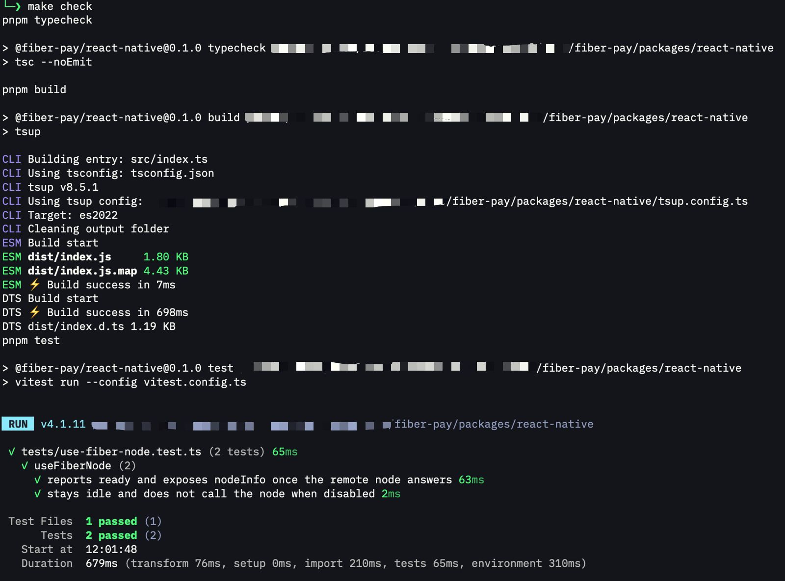

# Week 10 Report

**Week ending:** Oct 15, 2026

Capstone kicked off this week. Direction finally confirmed with Neon after a few rounds of "that already exists" on earlier ideas: build a React Native client for Fiber Network, targeting the gap we found a couple weeks ago in `khie-mobile`, as a fork + PR contribution to `fiber-pay` rather than a standalone project.

## What I learned

Scope got split into 3 milestones, one per report week, each ending in something Neon can actually review instead of one big drop at the end. Milestone 1 (this week) was: scaffold the package and prove it can connect to a real remote Fiber node.

Before writing anything, I actually read `@fiber-pay/sdk`'s source instead of guessing. Found that `FiberRpcClient` (the piece that talks to a Fiber node over JSON-RPC) only uses the global `fetch` and has zero Node-only or browser-only dependencies — so it already works in React Native as-is, no porting needed. The real gap is that `@fiber-pay/react`'s hooks assume a local WASM node running in-browser, which React Native can't do (no WASM + IndexedDB runtime like a browser has). So the new package doesn't try to run a node on-device — it connects to a remote `fnn` node over RPC instead, which is a much smaller, more honest scope than I originally assumed.

Built `@fiber-pay/react-native` with one hook so far, `useFiberNode({ url })`: polls a remote node's JSON-RPC endpoint until it answers, exposes connection state (`idle`/`connecting`/`ready`/`error`) and the raw `nodeInfo`. Wrote a real unit test for it (mocking `fetch`, not the whole client) instead of skipping tests because it's "just a hook." Then proved it end to end with a one-off smoke script against the actual `fnn` node still running from last week's Fiber work — confirmed it really reaches a live node, not just a mock.

Also added a `Makefile` to the package wrapping the existing `pnpm` scripts, since every other project I work in uses `make` and I wanted the same muscle memory here.

## Challenges

- The repo's pre-commit hook runs the *entire* monorepo's format/lint/typecheck/build/test on every commit, not just the touched package. First commit attempt failed because `vitest` errors out on a package with zero test files — had to add a real test before the commit would even go through, which was a good forcing function, not just a formality.
- Had to be deliberate about which SDK entry point to use. `@fiber-pay/sdk/node` adds server-only middleware (Node `crypto`) on top of the universal exports, which would've broken on React Native if I'd imported from there by habit instead of the plain `@fiber-pay/sdk` root.

## Screenshots

| | |
|---|---|
|  | `make check` in the new package — typecheck, build, and test all passing. |

Pushed the branch and opened a draft PR in my own fork (not upstream yet — want Milestone 1 reviewed first): https://github.com/mulhamna/fiber-pay/pull/1

## Next steps

Milestone 2 (Week 11): payment/invoice hooks (`useFiberPayment` or similar) on top of this foundation, demoed against a real channel. Milestone 1 goes to Neon for review before that starts.
