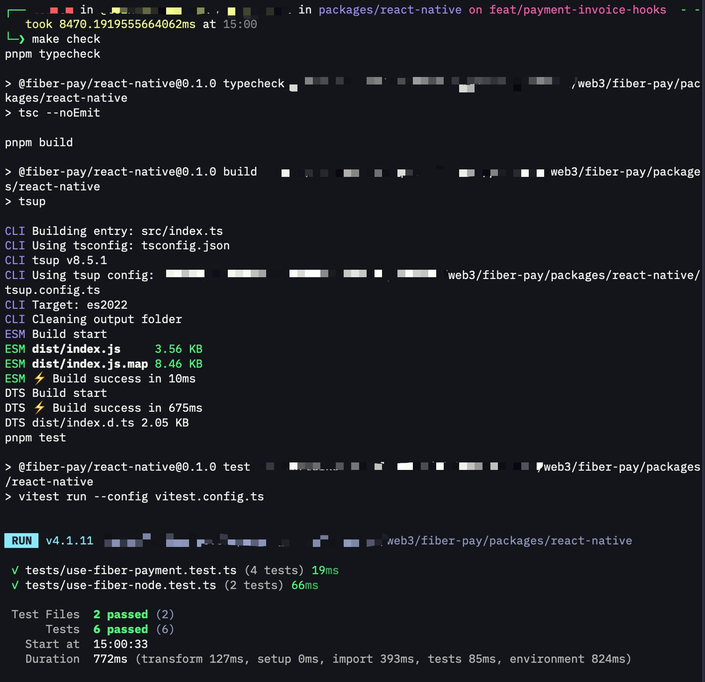
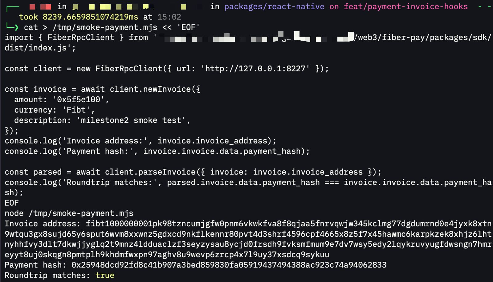

# Week 11 Report

**Week ending:** Oct 22, 2026

Milestone 2 of the capstone: payment and invoice hooks for `@fiber-pay/react-native`, building on top of the remote-node connection from Milestone 1.

## What I learned

Instead of designing the hook from scratch, I read `@fiber-pay/react`'s existing `useFiberPayment` first — it's the browser package's equivalent, built on a locally-running WASM node (`FiberBrowserNode`). The API shape (`parseInvoice`, `sendPayment`, `payInvoice`, `waitForPayment`) made sense to reuse as-is; the only real change needed was swapping `FiberBrowserNode` for `FiberRpcClient`, since the React Native version talks to a remote node over RPC instead of running one locally.

New hook: `useFiberPayment(client)`, taking the `client` that `useFiberNode` already returns. It exposes:
- `createInvoice` — wraps `newInvoice`, to receive a payment
- `parseInvoice` — decodes an invoice string without paying it
- `payInvoice` — parses, sends, and waits for settlement in one call, surfacing a routing failure as a thrown error instead of silently resolving

Kept it CKB-only for now (no UDT asset handling) — that's a feature the browser package already has a pattern for, so it can be ported later instead of guessed at now.

## Challenges

Two bugs showed up only once I wrote tests for the hook, not while writing the hook itself:

1. `createInvoice`/`parseInvoice` were originally synchronous arrow functions that just called into the client. When the client isn't ready yet, they threw synchronously instead of returning a rejected promise — so a caller doing `await hook.parseInvoice(...)` would never get a catchable rejection, it would just throw immediately. Fixed by marking both `async`.
2. A test that checked `error` state after a failed payment was reading state too early — `payInvoice`'s `setError` call hadn't flushed yet because the assertion wasn't wrapped in React Testing Library's `act()`. Easy to miss since the hook function itself was correct; it was purely a test-timing issue.

Also hit a scope limit: I can't fully prove `payInvoice` end-to-end against the live testnet node, because that needs two nodes with a channel that has liquidity in the right direction, and I currently only have the one `fnn` node from previous weeks. So the real evidence this week is split in two:
- `payInvoice`'s full flow (parse → send → wait → settle/fail) is proven by unit tests with a mocked RPC client, including the failure path.
- `createInvoice` + `parseInvoice` are proven against the actual live node on testnet, not just mocks.

## Screenshots

| | |
|---|---|
|  | `make check` — typecheck, build, and 6 tests (4 new for `useFiberPayment`, 2 from Milestone 1) all passing. |
|  | Real `createInvoice` + `parseInvoice` call against the live `fnn` testnet node, confirming the round trip matches. |

Pushed the branch and opened a draft PR in my own fork (same as Milestone 1, not upstream yet): https://github.com/mulhamna/fiber-pay/pull/2

## Next steps

Milestone 3 (Week 12): integrate the package into `khie-mobile` and open the PR upstream to `RetricSu/fiber-pay`. Also want to share Milestone 1 + 2 progress with the CKBuilders group to get feedback before going further.
