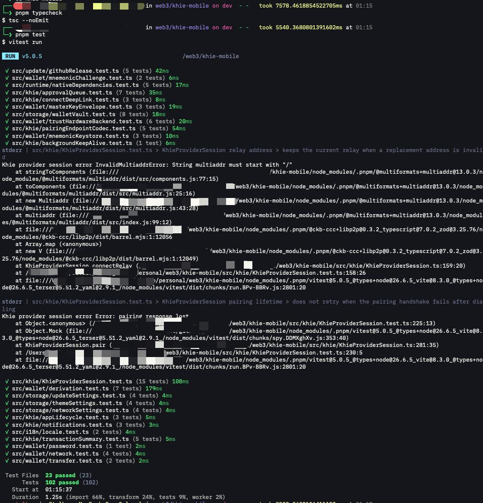

# Week 12 Report

**Week ending:** Oct 29, 2026

Milestone 3 of the capstone, part one: integrate `@fiber-pay/react-native` into `khie-mobile` (Hanssen0's React Native wallet for CKB) as a real-world consumer, proving the package works outside its own monorepo. Part two (PR upstream to `RetricSu/fiber-pay`) is next.

## What I learned

`khie-mobile` isn't just a bare React Native app — it's an Expo-managed, Android-first app with native modules (libp2p/WebRTC, a Trust hardware-wallet bridge) and its own `pnpm` workspace. `@fiber-pay/react-native` isn't published to npm, so the first problem was just getting it installed as a dependency at all.

The naive approach — a `file:` dependency pointing straight at `fiber-pay`'s source directory — breaks immediately, because that package declares `"@fiber-pay/sdk": "workspace:*"`, and `workspace:*` only resolves inside the `fiber-pay` monorepo's own pnpm workspace. `khie-mobile` has no idea that specifier exists. The fix was `pnpm pack`: packing both `@fiber-pay/sdk` and `@fiber-pay/react-native` rewrites `workspace:*` to the real pinned version in the resulting tarball, which is exactly what `pnpm pack`/`pnpm publish` are for. Installing from those two tarballs as `file:` dependencies in `khie-mobile` resolved cleanly.

Second decision: where does the integration code live? `khie-mobile`'s navigation and screen routing all live inside one ~65KB, ~2000-line `App.tsx` with its own hand-rolled state machine. Wiring a new screen into that file is real surgery on code I don't own and don't fully understand yet, so I kept the integration as a standalone component (`src/fiber/FiberDemoScreen.tsx`) that isn't imported from `App.tsx` at all. It proves the hooks work against `khie-mobile`'s actual React 19 / React Native 0.88 / Expo 58 stack without touching anything that's already working.

To verify it wasn't just satisfying `tsc`, I also bundled it through the real Metro bundler (`expo export:embed` with a throwaway entry file pointing only at the new component) — Metro resolves modules differently than TypeScript does, and that caught nothing TypeScript hadn't already, but it's the stronger proof: 796 modules bundled successfully, not just type-checked.

## Challenges

- `workspace:*` dependency resolution across two unrelated pnpm workspaces — covered above, solved with `pnpm pack`.
- Deciding not to wire the demo screen into `App.tsx`'s navigation was a deliberate scope cut, not a shortcut I'm happy about — it means this isn't a "real" feature yet, just proof the pieces fit together. Actually wiring it in (new tab or settings entry, state machine case, translations) is follow-up work, not something to rush into a file I don't want to accidentally break days before a report is due.
- Running the full app on an Android emulator (to get a real on-device screenshot) was out of scope for this milestone — `khie-mobile` needs Android Studio/SDK/an emulator or device, none of which are set up on this machine, and setting that up was a bigger time investment than the milestone needed. Typecheck + full existing test suite (102 tests) + a real Metro bundle of the new code is the evidence instead.

## Screenshots

| | |
|---|---|
|  | `pnpm typecheck` (clean) and `pnpm test` in `khie-mobile` itself — 23 test files, 102 tests, all passing with the new dependency installed. No regressions. |

## Next steps

Part two of Milestone 3: open the PR from my fork (`mulhamna/fiber-pay`) upstream to `RetricSu/fiber-pay`, now that both Milestone 1 and 2 are merged in my fork and reviewed.
